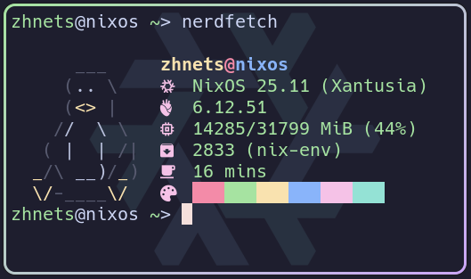

# Home-Manager - Catppuccin

<!--# Настроено-->

<!--
-->

<h1>Настроенно</h1>

<table>
<tr>
    <td>Alacritty</td>
    <td>Название</td>
    <td>Название</td>
</tr>
<tr>
    <td></td>
    <td></td>
    <td></td>
</tr>
<table>
